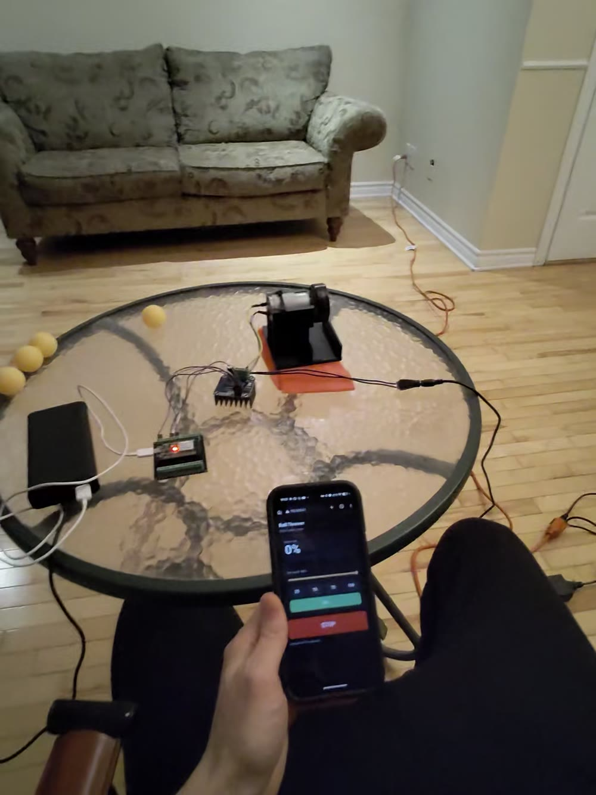

# Ping-Pong Ball Thrower

A phone-controlled ping-pong ball launcher: an ESP32 sets the speed of an RS550 motor through a BTS7960 driver. A 3D-printed wheel on the motor spins over the ball and flings it out of a printed lane.

https://github.com/user-attachments/assets/219ba44c-b2f9-4775-aa88-fa8af91f65d4



## How it works

The ESP32 joins your Wi-Fi network and serves a phone page with:

- a live speed readout;
- a 0–100 % slider with 25/50/75/100 presets;
- a **Go** button and a big **STOP** button.

The motor sits in a raised cradle above a 42 mm ball lane. A 57 mm wheel presses directly onto the motor's 10-tooth pinion. Its lower edge sits 2 mm below the top of a 40 mm ball, so a ball pushed into the lane is gripped and thrown forward.

Safety behaviour built into the firmware:

- it boots with the motor stopped and the driver disabled;
- speed changes ramp at 50 % per second, so 0 → 100 % takes 2 s;
- **STOP** is instant: PWM goes to 0 and the driver is disabled;
- if the page stops checking in for 3 s (phone locked, tab closed, out of range), the motor ramps to a stop.

## Parts list

| Qty | Part | Notes |
|---|---|---|
| 1 | ESP32 dev board (ESP-WROOM-32 DevKit) | Any ESP32 with GPIO 14/25/26/27 and a 5 V pin |
| 1 | BTS7960 / IBT-2 43 A H-bridge driver module | |
| 1 | RS550 12 V DC motor (10,000 RPM) with a fixed 10-tooth pinion | The wheel's socket fits a 10 mm OD, 10-tooth pinion with a 13 mm long toothed band; other pinions need a different socket |
| 1 | 12 V DC power supply | Rated for the motor; load current wasn't measured |
| 1 | 10–15 A inline fuse | On the 12 V positive lead |
| 1 | USB power for the ESP32 (power bank or charger) | |
| — | 16 AWG wire, 2 female spade terminals, jumper wires | Heavy wire for 12 V and motor; jumpers for logic only |
| — | Tape (e.g. electrical tape) | One even band around the wheel tread for grip |
| — | 40 mm ping-pong balls | |
| — | Non-slip mat (optional) | Under the base; holding the launcher down cut noise and vibration |

### Printed parts

| File | Part | Print |
|---|---|---|
| [`stl/launcher_base.stl`](stl/launcher_base.stl) | Base, ball lane, towers and raised motor cradle (one piece) | PLA, 0.2 mm layers, 5 walls, 30 % gyroid. **Needs tree supports** under the raised cradle. Block supports on the two front face pads, where the motor's pins locate. |
| [`stl/rear_door.stl`](stl/rear_door.stl) | Sliding rear door that keeps the motor in the cradle | Flat, no supports |
| [`stl/wheel_57mm.stl`](stl/wheel_57mm.stl) | 57 mm throwing wheel | PLA, 0.2 mm, 5 walls, 40 % gyroid. Closed face down, no supports |

[`print/launcher_base_bambu_p2s_0.4mm_tree_supports.3mf`](print/launcher_base_bambu_p2s_0.4mm_tree_supports.3mf) is a Bambu Studio project for the base. It's set up for a P2S with a 0.4 mm nozzle, with tree supports and two support blockers on the face pads. Check the settings in Prepare before you print.

Parametric sources (OpenSCAD) are in [`cad/`](cad):

- `launcher_base.scad`: `part = "base"`, `"door"` or `"assembly"`;
- `lib/motor_cradle.scad`: the cradle on its own;
- `wheel_57mm.scad`: needs OpenSCAD's bundled MCAD library.

Export with:

```sh
openscad --backend=manifold -D 'part="base"' -o stl/launcher_base.stl cad/launcher_base.scad
openscad --backend=manifold -D 'part="door"' -o stl/rear_door.stl cad/launcher_base.scad
openscad --backend=manifold -o stl/wheel_57mm.stl cad/wheel_57mm.scad
```

Key dimensions:

- motor shaft 66.5 mm above the lane floor;
- lane 42 mm wide between 3 mm × 20 mm high rails;
- motor cradle bore 39 mm, for the 38 mm motor envelope;
- face pins 2 mm diameter, 25.5 mm apart.

## Wiring

Full description: [`docs/wiring.md`](docs/wiring.md).

| ESP32 | BTS7960 |
|---|---|
| GPIO25 | `RPWM` |
| GPIO26 | `LPWM` |
| GPIO27 | `R_EN` |
| GPIO14 | `L_EN` |
| 5 V (VIN) | `VCC` |
| GND | `GND` |

| 12 V side | BTS7960 |
|---|---|
| Supply + (through a 10–15 A fuse) | `B+` |
| Supply − | `B−` |
| Motor tabs | `M+`, `M−` (swap them to reverse direction) |

Never connect 12 V to the ESP32 or the logic header.

## Assembly

1. Seat the motor in the cradle with its pinion through the front ring. The two face pins go into the motor's front mounting holes, which stops the motor turning.
2. Slide the rear door down into its grooves behind the motor.
3. Press the wheel onto the pinion.
4. Wrap one even band of tape around the wheel's tread. Bare PLA throws only a short distance; tape makes a large difference.
5. Wire as above and run a short first test with no ball.

## Build and flash

You need [arduino-cli](https://arduino.github.io/arduino-cli/) or the Arduino IDE, and the ESP32 core (tested with 3.3.8). No extra libraries are needed.

```sh
arduino-cli core install esp32:esp32
```

1. Create your config:

   ```sh
   cp firmware/ball_thrower/config.example.h firmware/ball_thrower/config.h
   ```

   In `config.h`, set:
   - your Wi-Fi name and password (2.4 GHz network);
   - the fallback access point password.

   `config.h` is git-ignored. Without it, the board starts its own `BallThrower` network.

2. Compile and upload (replace the port with yours: `arduino-cli board list`):

   ```sh
   arduino-cli compile --fqbn esp32:esp32:esp32 firmware/ball_thrower
   arduino-cli upload -p /dev/cu.usbserial-XXXX --fqbn esp32:esp32:esp32 firmware/ball_thrower
   ```

3. Open the serial monitor at 115200 baud to see the IP address:

   ```sh
   arduino-cli monitor -p /dev/cu.usbserial-XXXX -c baudrate=115200
   ```

## Usage

1. Power the ESP32 and the 12 V supply.
2. On your phone, open `http://ballthrower.local`, or the IP printed on serial. Android often can't resolve `.local` names, so use the IP there.
3. Pick a speed (slider or preset) and tap **Go**. The motor ramps up.
4. Push a ball along the lane under the wheel; it's gripped and thrown.
5. Tap **STOP** when done. Locking the phone or closing the tab also stops the motor within about 3 s.

**If the board can't join your Wi-Fi within 30 s**, it starts its own network `BallThrower` (password from `config.h`). Join that network and open `http://192.168.4.1`. On Android, turn off mobile data if the page won't load. Reset the board to retry your home Wi-Fi.

### HTTP endpoints

| Path | Action |
|---|---|
| `/` | Phone page |
| `/set?p=0..100` | Set target speed (%) |
| `/stop` | Stop now |
| `/hb` | Heartbeat (the page calls this every 0.5 s) |
| `/state` | JSON: target, current, driver enabled, last stop reason |

## Safety

- Keep fingers, hair and loose wires away from the spinning wheel.
- Don't aim it at people's faces or at anything fragile.
- Unplug the 12 V supply when you're not using it.
- The fallback access point controls a motor. Set your own `AP_PASSWORD`.

## License

MIT. See [LICENSE](LICENSE).
